# How it works

In one line: MusicGen makes short audio from a written prompt; the symbolic model learns pitch-and-tick patterns from MIDI and writes MIDI back.

## Two ways to generate music

This repository contains two distinct generation experiments. The first uses a pretrained text-to-audio model. The second trains a small symbolic music model from MIDI in this repository using the method described in `s-zeng/rag-shenanigann`.

### Track A: prompt-conditioned MusicGen audio

The MusicGen path asks Meta's `facebook/musicgen-small` checkpoint to generate short audio from a written music brief. A text encoder represents the prompt, an autoregressive Transformer samples discrete audio-code tokens, and an EnCodec decoder reconstructs a waveform. The project uses Hugging Face Transformers and records the prompt, checkpoint, duration, seed, sampling controls, device, library versions, sample rate, and output duration in JSON next to each WAV.

Boogie-Woogie prompts state the intended piano ensemble, left-hand bass role, right-hand riffs, shuffle/swing feel, blues form, and absence of vocals. These are soft conditions: the model can drift from the brief and does not guarantee a BPM, meter, chord sequence, exact 12-bar form, hand independence, or note-level Boogie-Woogie accuracy.

Primary technical references: [MusicGen paper](https://arxiv.org/abs/2306.05284), [AudioCraft MusicGen documentation](https://github.com/facebookresearch/audiocraft/blob/main/docs/MUSICGEN.md), [Hugging Face model documentation](https://huggingface.co/docs/transformers/en/model_doc/musicgen), and the [MusicGen model card](https://github.com/facebookresearch/audiocraft/blob/main/model_cards/MUSICGEN_MODEL_CARD.md).

### Track B: MIDI character LSTM

This path adapts the reference's symbolic sequence method to Boogie-Woogie. It is custom training performed by this repository, not a pretrained music model and not text-prompted generation.

1. Select MIDI scores from PDMX v8, retain their source fields and hashes in a manifest, and convert each multi-track MIDI to Type 0.
2. Use `midicsv` to read the MIDI header and events. Preserve PPQN, the first tempo, and positive-velocity note-on pitches only.
3. Encode each pitch as `chr(33 + pitch)`. Concatenate characters for pitches on the same absolute tick. Put one space between consecutive tick slots, including blank slots. Separate pieces with three newlines.
4. Train a character-level LSTM to predict the next character from fixed-length windows sampled from the concatenated corpus. The modern path uses PyTorch, embeddings, cross-entropy, AdamW, and gradient clipping. The documented legacy path uses upstream Torch7 `torch-rnn` in the `crisbal/torch-rnn:base` Docker image.
5. Sample a new note stream. The modern sampler uses the first record's PPQN/tempo prefix and restricts tokens to the observed pitch alphabet plus space, so generated text remains decodable.
6. Reconstruct a MIDI CSV file and MIDI file. `csvmidi` is preferred when installed; Mido is included as a fallback writer.

The full MIDI sequence is documented in the walkthrough below.

#### What the symbolic model can learn

The LSTM estimates the next-character distribution over one compact serialized score representation. It can learn frequent pitch/tick patterns in the six training items. It does not receive a natural-language prompt, explicit chord labels, part labels, bar markers, note durations, or a formal theory representation. The corpus is deliberately small and is useful for demonstrating an end-to-end data/model pipeline, not for a strong claim about genre-wide composition.

#### Information loss and decoder assumptions

The text representation drops note-off timing, durations, original velocities, instrument programs, channels, separate hands, later tempo changes, sustain pedal, key/time signatures, and other performance controls. It uses a single note character per note-on, so same-tick chords are represented by adjacent characters. MIDI reconstruction assigns velocity 96 and keeps a pitch active until a later tick group changes or clears it. These are explicit simplifications of the reference method.

The reference decoder uses character-string offsets for event times, so chord width can affect reconstructed timing. This implementation uses tick-slot indices instead and closes final notes before end-of-track. That improves temporal consistency and MIDI validity but does not restore information discarded before training.

### Evaluation

The MusicGen sample is a pipeline demonstration. The symbolic LSTM sample is a generated MIDI continuation with a recorded seed, temperature, checkpoint hash, corpus hash, PPQN, tempo, and requested tick count. Neither is a benchmark. See [results and next steps](results-and-next-steps.md) for the measurements and listening plan.

## Full MIDI walkthrough

This walkthrough follows one score through the Boogie-Woogie adaptation of [`s-zeng/rag-shenanigann`](https://github.com/s-zeng/rag-shenanigann), from source MIDI to generated MIDI.

### Pipeline at a glance

```mermaid
flowchart LR
    A[PDMX v8 MIDI scores] --> B[Curated source manifest]
    B --> C[Merge tracks into Type 0]
    C --> D[midicsv: MIDI to CSV]
    D --> E[PPQN + tempo + pitch characters per tick]
    E --> F[Character LSTM training]
    F --> G[Sample a new note stream]
    G --> H[unprocess: note stream to MIDI CSV]
    H --> I[csvmidi: CSV to MIDI]
    I --> J[Listen, inspect, or edit MIDI]
```



### How the reference maps to this project

| Reference stage | Reference implementation | This repository |
| --- | --- | --- |
| Acquire MIDI | `scripts/grab.py` downloads from two hard-coded listing pages, or use bundled `rag/` MIDI | Six curated PDMX v8 MIDI files in `data/raw_midi/`, with source identifiers, license metadata, and SHA-256 in `data/manifest.csv` |
| Convert to Type 0 | Optional `gnmidifmt` or an equivalent converter | `scripts/normalize_type0.py` merges tracks with Python `mido`, retaining the common tick timeline and MIDI meta events |
| Convert MIDI to text | `midicsv` plus `scripts/process.py` | Fourmilab `midicsv` plus this project's `scripts/process.py` |
| Text representation | PPQN, first tempo, then `chr(33 + pitch)` per positive-velocity note-on; spaces separate ticks; files separated by three newlines | Same representation and separators, with input validation, deterministic ordering, bounded tick allocation, and an auditable processing manifest |
| Train | `torch-rnn` (Torch7 character-level recurrent model, commonly LSTM) | A modern, runnable PyTorch character LSTM; the legacy `crisbal/torch-rnn` Docker route is also documented below |
| Sample | `sample.lua` emits a character continuation | `scripts/generate_char_rnn.py` samples the trained LSTM with a valid PPQN/tempo prefix and restricts symbols to the learned pitch alphabet plus spaces |
| Reconstruct MIDI | `scripts/unprocess.py` writes CSV; `csvmidi` writes MIDI | `scripts/unprocess.py` writes CSV and invokes `csvmidi`; it can use Mido when `csvmidi` is not installed |

The project reimplements the described method from scratch. It does not copy the reference's code or data. The reference is licensed AGPL-3.0; this project's own code remains under the repository's MIT license.

### Source data and curation

The source is the PDMX dataset, version v8 (Zenodo record `10.5281/zenodo.14984509`). The files are six MIDI entries from its `mid.tar.gz` archive. We filtered the metadata for clearly Boogie-Woogie or blues piano/bass titles and selected entries whose per-score license is recorded as `cc-zero`, whose `license_conflict` is `False`, and for which a MIDI file is available. The selected rows are listed in [`data/manifest.csv`](../data/manifest.csv); the curation and count conventions are in [`data/README.md`](../data/README.md).

PDMX says its public-facing license metadata disagreed with embedded license metadata for 31,221 (12.29%) entries and recommends its `no_license_conflict` subset. All six selected records are flagged as having no conflict. That reduces one known risk but does not independently establish copyright ownership or guarantee that a user-uploaded transcription/arrangement has no third-party rights. The `is_original` field is retained rather than interpreted as a rights clearance.

The bundled scores are a small, hand-curated portfolio sample, not a representative corpus. Four PDMX rows are marked `is_original=True`; two historical score entries are marked `False`. The MIDI file's actual positive-velocity note-on count may differ from PDMX's score-level `n_notes`; both values are preserved in the manifest because they are generated by different parsing paths.

### Type-0 normalization

The reference recommends placing notes from all parts on one track before running the recurrent model. The included six raw files are MIDI Type 1; some contain several tracks. `normalize_type0.py` uses Mido to merge their delta-timed event streams into one absolute-time-ordered track and writes Type-0 MIDI under `data/normalized_midi/`:

```powershell
python scripts/normalize_type0.py --input data/raw_midi --output data/normalized_midi
```

Mido is used only for this format conversion and the optional output fallback. For the reference-compatible serialization and decode, the pipeline uses Fourmilab's `midicsv` and `csvmidi`. The reference README also names `gnmidifmt` as an optional way to convert types; this project does not require it.

### Text encoding

For each normalized MIDI file, `scripts/process.py` calls `midicsv` and reads the resulting CSV records. It writes a block with three lines/fields:

1. **PPQN** (ticks per quarter note), copied from the MIDI `Header` record.
2. **Tempo**, the first `Tempo` event in microseconds per quarter note.
3. **Tick/pitch stream**, with each positive-velocity `Note_on_c` pitch represented by `chr(33 + pitch)`. Notes beginning on the same tick become adjacent characters. A literal space represents the boundary to the next MIDI tick. The next MIDI file begins after three newline characters.

The checked-in corpus was produced with Fourmilab `midicsv` from the six Type-0 files. It contains 672,098 tick slots and 5,390 positive-velocity note-on events. See `data/processed/processing_manifest.csv` for per-file PPQN, tempo, tick count, event count, and encoded string length. Rebuild it with:

```powershell
python scripts/process.py `
  --input data/normalized_midi `
  --output data/processed/training_data.txt `
  --manifest data/processed/processing_manifest.csv `
  --midicsv midicsv `
  --midicsv-version "Fourmilab MIDICSV 1.1"
```

The pitch mapping is exactly the reference's `chr(33 + pitch)` mapping. The selected source notes range from MIDI pitch 24 to 93, which maps to printable ASCII and keeps the corpus compatible with the byte-oriented legacy Torch7 path. A source containing pitch 94 or higher is rejected by this implementation rather than silently introducing control or multibyte characters.

#### Information discarded by the representation

This is intentionally a compact, lossy encoding. It records only PPQN, the first tempo event, onset tick, and pitch. It drops note-off events and durations, original velocity, instrument/program, channel, hand/part identity, later tempo changes, key/time signatures, pedals, and expressive controls. Converting to Type 0 merges parts and removes explicit left/right-hand structure. Chord simultaneity is represented only by adjacent pitch characters. The output therefore models a stream of pitches and tick boundaries, not a complete expressive performance.

### Model training and sampling

#### Modern, runnable PyTorch implementation

`scripts/train_char_rnn.py` trains a small character-level LSTM with an embedding layer, one or more recurrent layers, a vocabulary projection, AdamW, cross-entropy, and gradient clipping. Each optimization step samples batches of fixed-length windows from the processed corpus. Its checkpoint stores the vocabulary, architecture, training settings, corpus SHA-256, seed, final loss, and software versions. The CSV log preserves the loss for each step.

```powershell
python scripts/train_char_rnn.py `
  --input data/processed/training_data.txt `
  --checkpoint models/boogie-char-lstm.pt `
  --log outputs/symbolic/training-loss.csv `
  --steps 1000 `
  --sequence-length 128 `
  --batch-size 8 `
  --seed 42
```

Sampling starts with the first corpus record's PPQN and tempo. The sampler restricts output to the source pitch characters and the space separator, preventing header digits or newline characters from being misread as notes. `--ticks` controls the generated number of tick slots; with 480 PPQN and 500,000 microseconds per quarter note, 4,800 slots correspond to 5 seconds.

```powershell
python scripts/generate_char_rnn.py `
  --checkpoint models/boogie-char-lstm.pt `
  --output outputs/symbolic/boogie-rnn-demo.txt `
  --ticks 4800 `
  --temperature 1.0 `
  --seed 73
```

The result is a new character stream sampled by a model trained in this repository. It is not conditioned on natural-language prompts. A seed makes the sampling repeatable within a compatible runtime, but does not promise byte-identical output across PyTorch versions and hardware.

#### Legacy Torch7 `torch-rnn` compatibility route

The original tool named in the rag-shenanigann README is `torch-rnn`, a Lua/Torch7 character-level RNN/LSTM. The referenced Docker image is `crisbal/torch-rnn:base`, based on Ubuntu 14.04 and configured for CPU use. Its Dockerfile clones the upstream `jcjohnson/torch-rnn` implementation and installs Torch7, Python 2.7, HDF5, and Lua dependencies. This is a historically faithful option, but it is an old software stack and may require an older Docker host or compatibility work. Docker was not available in the authoring environment, so no Torch7 model was trained here.

From the repository root, start the container and expose the project files:

```bash
docker run --rm -it -v "$PWD:/workspace" crisbal/torch-rnn:base bash
```

Inside the container, `WORKDIR` is `/root/torch-rnn`:

```bash
mkdir -p /workspace/data/processed /workspace/models/torch7
python scripts/preprocess.py \
  --input_txt /workspace/data/processed/training_data.txt \
  --output_h5 /workspace/data/processed/boogie-rnn.h5 \
  --output_json /workspace/data/processed/boogie-rnn.json
th train.lua \
  -input_h5 /workspace/data/processed/boogie-rnn.h5 \
  -input_json /workspace/data/processed/boogie-rnn.json \
  -gpu -1 \
  -checkpoint_every 1000 \
  -checkpoint_name /workspace/models/torch7/boogie
```

The upstream Docker instructions use the same preprocessing/training flags and sample from a saved `.t7` checkpoint. Choose an actual checkpoint filename printed during training, then sample a continuation:

```bash
th sample.lua \
  -checkpoint /workspace/models/torch7/boogie_1000.t7 \
  -length 5000 \
  -gpu -1 \
  -start_text $'480\n500000\n' \
  > /workspace/outputs/symbolic/torch7-continuation.txt
```

The checkpoint suffix depends on the iterations completed. For valid decoding, retain the two metadata lines and a note stream composed of pitch symbols and spaces. The original Torch7 sampler is unconstrained; it can sample newlines or header characters in its continuation, which must be cleaned before sending it through the MIDI decoder. The modern PyTorch sampler avoids this by restricting its output alphabet.

### Decode and output MIDI

`scripts/unprocess.py` writes a `midicsv`-format CSV and then calls `csvmidi -z` to create a MIDI file. If `csvmidi` is unavailable, it can use Mido to create the equivalent Type-0 output:

```powershell
python scripts/unprocess.py outputs/symbolic/boogie-rnn-demo.txt `
  --output-dir outputs/symbolic `
  --prefix boogie-rnn-demo `
  --midi-backend csvmidi `
  --csvmidi csvmidi `
  --csvmidi-version "Fourmilab MIDICSV 1.1"
```

The decoded format infers note lengths because the text encoding contains no duration or note-off token: each pitch remains active until the generated tick stream changes to another pitch group or a blank slot. Generated notes use velocity 96, as in the reference's decoder. The decoder fixes two issues in the reference script: it measures event time in tick slots rather than character offsets (so chord size does not shift timing), and it closes the final active notes before the end-of-track event.

The repository includes a generated MIDI, the source character stream, a JSON generation recipe, the LSTM checkpoint, its metadata, and the training-loss CSV. A MIDI player or DAW can open the `.mid`; a soundfont renderer such as TiMidity++ can produce audio on machines where one is installed.

#### Committed run record

The checked-in training run used 1,000 optimization steps, 128-character windows, batch size 8, 32-dimensional embeddings, a 96-unit two-layer LSTM, AdamW at 0.002, and seed 42 on CPU. Its first and last sampled minibatch cross-entropies were 4.2998 and 0.0480. The generated demonstration used seed 73, temperature 1.0, 4,800 tick slots, 480 PPQN, and 500,000 microseconds per quarter note. It produced 40 pitch characters and decoded to a 5-second Type-0 MIDI with 38 positive-velocity note-on events in pitches 28–77. The character count and MIDI note-on count differ because repeated pitches and adjacent tick groups are decoded as continuous active notes. The loss values describe optimization on sampled training windows only; there is no validation set or independent quality score.

### Quality and limitations

- Six pieces are too few to characterize the genre or claim generalization. Many events in these files come from exercises and short examples.
- The recurrent model learns a continuation distribution over the serialized training symbols. It does not understand harmony, blues form, hand independence, or a natural-language style prompt as explicit concepts.
- Because the data is a dense tick grid, the corpus is dominated by spaces. This matches the reference but can make optimization inefficient and generated note density sensitive to sampling settings.
- Note duration reconstruction is an inference; the original durations are irrecoverable after preprocessing.
- No objective style, form, or musicality benchmark is claimed. The committed generation is a reproducible example and should be evaluated by listening and inspecting the MIDI.

### Tool references

- [Reference repository and scripts](https://github.com/s-zeng/rag-shenanigann)
- [Fourmilab MIDICSV documentation and downloads](https://www.fourmilab.ch/webtools/midicsv/)
- [Upstream `jcjohnson/torch-rnn`](https://github.com/jcjohnson/torch-rnn)
- [CPU Docker image instructions](https://github.com/crisbal/docker-torch-rnn)
- [PDMX dataset record](https://doi.org/10.5281/zenodo.14984509)

